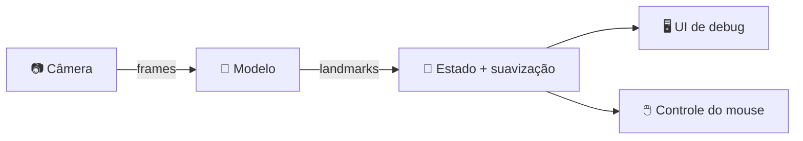

<div align="center">

# ✋ motion_track

**Controle o mouse com as mãos, usando apenas uma webcam.**

Rastreamento de landmarks da mão em tempo real, escrito em Rust.


</div>

---

## Sobre

`motion_track` captura o vídeo da sua webcam, detecta os pontos-chave (*landmarks*) da mão com um modelo de visão computacional e transforma esses movimentos em comandos de mouse: mover o cursor, clicar e arrastar, sem tocar em nada.

## Pipeline



| # | Etapa | Descrição |
|:-:|-------|-----------|
| 1 | **Captura** | Lê os frames da webcam |
| 2 | **Inferência** | Envia cada frame ao modelo, que extrai os landmarks da mão |
| 3 | **Estado** | Armazena e suaviza as posições dos landmarks |
| 4 | **Visualização** | Desenha o vídeo e os landmarks numa janela |
| 5 | **Controle** | Converte os landmarks em movimento e cliques do mouse |

## Checklist

### 1. 📷 Captura
- [x] Listar as câmeras disponíveis
- [x] Abrir a câmera e capturar um frame
- [ ] Captura contínua numa thread dedicada
- [ ] Converter o frame para RGB
- [ ] Espelhar o frame na horizontal
- [ ] Fixar uma resolução leve (ex.: 640×480)

### 2. 🧠 Inferência
- [ ] Escolher e baixar os modelos (detector de palma + landmarks, em ONNX)
- [ ] Integrar o runtime de inferência ([`ort`](https://crates.io/crates/ort))
- [ ] Pré-processar o frame (resize com letterbox + normalização)
- [ ] Rodar o detector de palma
- [ ] Recortar a mão e rodar o modelo de landmarks (21 pontos)
- [ ] Reaproveitar o recorte do frame anterior (rodar o detector só quando a mão for perdida)

### 3. 💾 Estado
- [ ] Estrutura para guardar os 21 landmarks por frame
- [ ] Suavização com One Euro Filter
- [ ] Compartilhar o estado entre as threads

### 4. 🖥️ Visualização
- [x] Janela base com GPUI
- [ ] Exibir o vídeo da câmera em tempo real (`RenderImage` em BGRA)
- [ ] Desenhar os landmarks e as conexões sobre o vídeo
- [ ] Mostrar o FPS e a latência
- [ ] Sliders para calibração

### 5. 🖱️ Controle do mouse
- [ ] Integrar o [`enigo`](https://crates.io/crates/enigo)
- [ ] Mapear uma área útil da câmera para a tela inteira
- [ ] Mover o cursor com o indicador
- [ ] Clique por pinça (polegar + indicador), normalizado pelo tamanho da mão
- [ ] Histerese no clique, para ele não ficar "piscando"
- [ ] Arrastar (manter a pinça)
- [ ] Atalho para ligar e desligar o controle

### ⚙️ Arquitetura
- [ ] Canal com capacidade 1 entre a câmera e a inferência (descarta frames velhos)
- [ ] Separar o código em módulos (`camera`, `model`, `tracking`, `ui`, `input`)

## Stack

| Crate | Uso |
|-------|-----|
| [`nokhwa`](https://crates.io/crates/nokhwa) | Captura da webcam |
| [`gpui-kit`](https://crates.io/crates/gpui-kit) | Interface gráfica acelerada por GPU |
| [`tokio`](https://crates.io/crates/tokio) | Runtime assíncrono |
| [`tracing`](https://crates.io/crates/tracing) | Logs estruturados |
| [`anyhow`](https://crates.io/crates/anyhow) | Tratamento de erros |
| [`ort`](https://crates.io/crates/ort) *(planejado)* | Inferência dos modelos ONNX |
| [`enigo`](https://crates.io/crates/enigo) *(planejado)* | Controle do mouse |

## Como rodar

**Pré-requisitos:** [Rust](https://rustup.rs) atualizado (edition 2024) e uma webcam conectada.

```bash
git clone <url-do-repositorio>
cd motion_track
cargo run --release
```

> [!TIP]
> Use `--release`. Em modo debug, a captura e a inferência ficam bem mais lentas.

## Estrutura

```
motion_track/
├── src/
│   └── main.rs      # entrada: câmera + janela
├── pipeline.txt     # rascunho da pipeline
└── Cargo.toml
```

---

<div align="center">
<sub>Feito com 🦀 Rust</sub>
</div>
